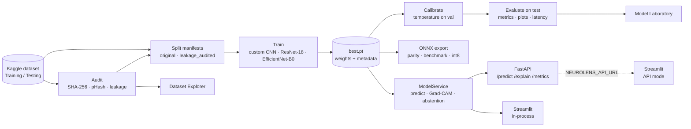
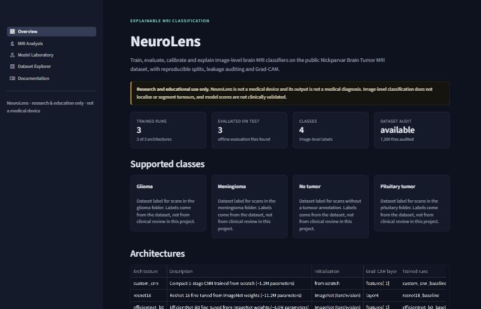
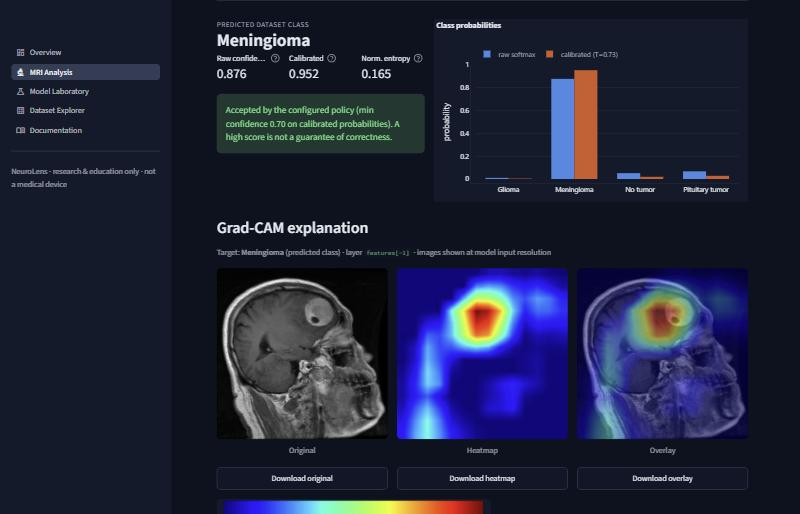
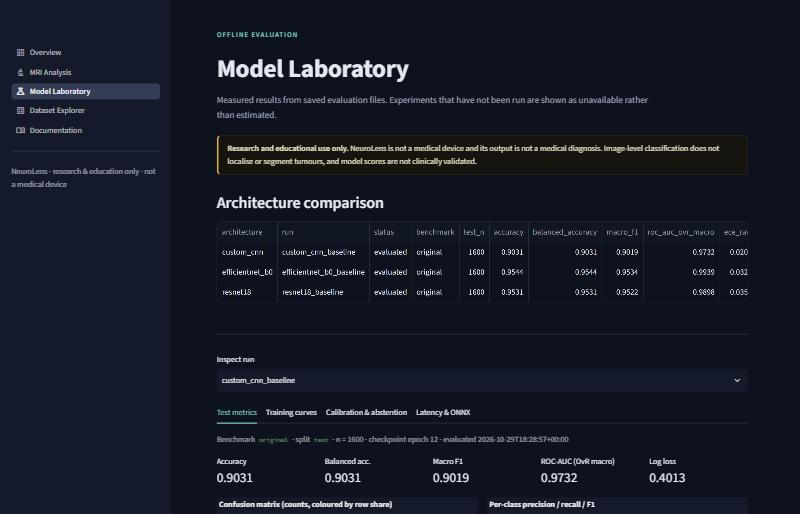
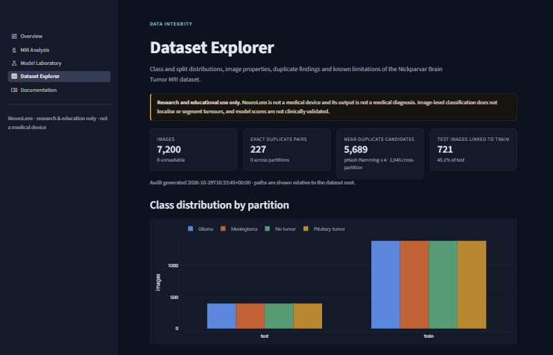

# NeuroLens

**Explainable brain MRI image classification and model evaluation platform — PyTorch training,
leakage auditing, calibration, Grad-CAM, ONNX Runtime, FastAPI and Streamlit.**

> [!WARNING]
> NeuroLens is for **machine-learning research and education only**. It is not a medical device,
> has not been clinically validated, and its output is not a medical diagnosis. Image-level
> classification does not localise or segment tumours.

NeuroLens classifies a single brain MRI slice into one of the four labels of the
[Masoud Nickparvar Brain Tumor MRI Dataset](https://www.kaggle.com/datasets/masoudnickparvar/brain-tumor-mri-dataset)
(*glioma*, *meningioma*, *pituitary tumor*, *no tumor*) and wraps the model in the engineering
around it: a dataset integrity audit, reproducible and leakage-aware splits, three architectures,
calibrated probabilities with abstention, Grad-CAM explanations, latency benchmarks, ONNX export,
a typed REST API, a web interface, tests and CI.

*Suggested GitHub description:* Explainable brain-MRI classification research platform: PyTorch
training, dataset leakage audit, calibration, Grad-CAM, ONNX, FastAPI & Streamlit.

---

## Contents

[Features](#key-features) · [Architecture](#architecture) · [Tech stack](#tech-stack) ·
[Structure](#repository-structure) · [Install](#installation) · [Dataset](#dataset) ·
[Quick start](#quick-start) · [Train](#training) · [Evaluate](#evaluation-calibration-and-comparison) ·
[Explain](#grad-cam) · [ONNX](#onnx-export-and-benchmarks) · [API](#api) · [Web app](#web-app) ·
[Docker](#docker) · [Tests](#testing-and-linting) · [Results](#results) ·
[Limitations](#limitations-and-ethical-considerations) · [Troubleshooting](#troubleshooting) ·
[License](#license)

## Key features

- **Dataset discovery & audit** — validates the `Training`/`Testing` layout (wrapper folders and
  class aliases allowed), reports counts, sizes, formats and unreadable files, finds **exact
  duplicates** (SHA-256) and **near-duplicate candidates** (DCT perceptual hash), and quantifies
  train/test **leakage**. Nothing is deleted or moved.
- **Two clearly separated benchmarks** — the *original* test set, untouched, and an optional
  *leakage-audited* benchmark with group-aware validation splitting and duplicate-linked test
  images removed (every exclusion listed).
- **Three architectures** — a compact CNN from scratch, ResNet-18 and EfficientNet-B0 (ImageNet
  transfer learning), selectable by config or CLI.
- **Reproducible training** — YAML configs with dotted CLI overrides, seeds, stratified splits,
  AMP on CUDA, early stopping, best-checkpoint selection on validation, resumable `last.pt`,
  CSV/JSONL logs, and checkpoint metadata (classes, preprocessing, config, versions).
- **Evaluation** — accuracy, balanced accuracy, macro & per-class P/R/F1, confusion matrix,
  classification report, one-vs-rest ROC-AUC, log loss, parameter count, model size, latency and
  throughput with documented conditions; plots and a comparison table that lists untrained
  architectures as *not trained*.
- **Calibration & uncertainty** — temperature scaling fitted on validation data, ECE with
  documented binning, reliability diagrams, entropy, configurable abstention and coverage–risk
  analysis. Raw and calibrated probabilities are always reported separately.
- **Grad-CAM** — computed from the trained model with proper hook cleanup and gradient handling;
  original / heatmap / overlay / legend downloadable; explicit interpretation caveats.
- **ONNX** — export, `onnx.checker`, ONNX Runtime parity against PyTorch with a tolerance, CPU
  benchmarks and optional int8 dynamic quantization reported as measured.
- **FastAPI** — `/health`, `/models`, `/predict`, `/explain`, `/metrics`; Pydantic schemas,
  upload limits, format validation, correct status codes, models loaded once at startup, 503 when
  no model is trained, no client-supplied paths.
- **Streamlit** — Overview, MRI Analysis, Model Laboratory, Dataset Explorer and Documentation
  pages in a restrained dark research theme; every number comes from a real file.
- **Quality** — pytest suite on synthetic data (no dataset/GPU needed), Ruff, type hints,
  structured logging, Docker, Docker Compose and GitHub Actions.

## Architecture



More detail and design decisions: [docs/architecture.md](docs/architecture.md).

## Tech stack

Python 3.10–3.13 (CI: 3.11, 3.12) · PyTorch & torchvision · NumPy · pandas · scikit-learn ·
SciPy · Matplotlib · Plotly · Pillow · FastAPI · Uvicorn · Pydantic · Streamlit · ONNX & ONNX
Runtime · pytest · Ruff · Docker · GitHub Actions.

OpenCV is intentionally not used: Pillow, NumPy and SciPy already cover decoding, resizing, the
DCT for perceptual hashing and colour mapping. Dependency ranges are constrained in
[`pyproject.toml`](pyproject.toml).

## Repository structure

```
neurolens/
├── api/                     FastAPI app: main.py, routes.py, schemas.py, service.py, settings.py
├── app/                     Streamlit: streamlit_app.py, ui.py, backend.py, views/*.py
├── src/neurolens/
│   ├── data/                classes, discovery, dataset, transforms, audit, splits
│   ├── models/              custom_cnn, factory (registry + Grad-CAM layers)
│   ├── training/            config, trainer, checkpoint
│   ├── evaluation/          metrics, calibration, benchmark, plots, evaluate, compare
│   ├── explainability/      gradcam, overlay
│   ├── inference/           predictor, registry, image_io
│   ├── optimization/        onnx_export
│   └── cli.py               `neurolens` command
├── configs/                 resnet18, efficientnet_b0, custom_cnn, resnet18_leakage_audited
├── scripts/                 thin wrappers: python scripts/train.py --config …
├── tests/                   pytest suite (synthetic images, temp dirs)
├── docs/                    architecture, setup, training, explainability, ONNX, API, limitations
├── reports/                 what each generated report contains
├── artifacts/               runtime outputs (git-ignored)
├── data/                    dataset location (git-ignored)
├── .streamlit/config.toml   UI theme
├── Dockerfile · docker-compose.yml · Makefile · pyproject.toml · .env.example
└── .github/workflows/ci.yml
```

## Installation

Requires Python 3.10–3.13. A CUDA GPU is optional (CPU works, but training is slow).

**Linux / macOS**

```bash
git clone <your-fork-url> neurolens && cd neurolens
python3 -m venv .venv && source .venv/bin/activate
pip install --upgrade pip
pip install -e ".[all]"
```

**Windows (PowerShell)**

```powershell
git clone <your-fork-url> neurolens; cd neurolens
py -3.12 -m venv .venv; .\.venv\Scripts\Activate.ps1
python -m pip install --upgrade pip
pip install -e ".[all]"
```

**GPU (NVIDIA):** install the CUDA build of PyTorch *before* the project, choosing the CUDA
version for your driver from <https://pytorch.org/get-started/locally/>, e.g.

```bash
pip install torch torchvision --index-url https://download.pytorch.org/whl/cu128
pip install -e ".[all]"
```

Extras: `api`, `app`, `onnx`, `dev`, or `all`. Without installing, the `scripts/*.py` wrappers
still work (`python scripts/train.py --config configs/resnet18.yaml`).

## Dataset

1. Download the dataset from Kaggle (browser, or `kaggle datasets download -d
   masoudnickparvar/brain-tumor-mri-dataset -p data/raw` with your own API token). NeuroLens
   never downloads it for you and never needs credentials.
2. Extract to `data/raw/brain-tumor-mri-dataset/` so it contains `Training/` and `Testing/`, each
   with `glioma/ meningioma/ notumor/ pituitary/`.
3. Audit it:

```bash
neurolens audit --data-root data/raw/brain-tumor-mri-dataset
```

Full instructions, split procedures and the leakage-audited benchmark: [docs/setup.md](docs/setup.md).

## Quick start

```bash
neurolens audit    --data-root data/raw/brain-tumor-mri-dataset
neurolens train    --config configs/resnet18.yaml
neurolens calibrate --run resnet18_baseline
neurolens evaluate --run resnet18_baseline
neurolens compare
uvicorn api.main:app --port 8000          # http://localhost:8000/docs
streamlit run app/streamlit_app.py        # http://localhost:8501
```

`make audit train calibrate evaluate compare` does the same with GNU make.

## Training

```bash
neurolens train --config configs/resnet18.yaml
neurolens train --config configs/efficientnet_b0.yaml
neurolens train --config configs/custom_cnn.yaml
neurolens train --config configs/resnet18.yaml --epochs 5 --batch-size 16 --device cpu
neurolens train --config configs/resnet18.yaml --set training.lr=1e-4 --set training.monitor=val_loss
neurolens train --config configs/resnet18.yaml --resume
neurolens train --config configs/resnet18_leakage_audited.yaml   # needs `neurolens audit` first
```

Outputs go to `artifacts/runs/<experiment_name>/` (`best.pt`, `last.pt`, `history.csv`, the
exact config and split). Transfer-learning configs download ImageNet weights from torchvision
once; set `model.pretrained: false` to avoid that. Details: [docs/training_evaluation.md](docs/training_evaluation.md).

## Evaluation, calibration and comparison

```bash
neurolens calibrate --run resnet18_baseline      # temperature on the validation split
neurolens evaluate  --run resnet18_baseline      # test split -> eval/test/metrics.json + plots
neurolens benchmark --run resnet18_baseline --device cpu --batch-sizes 1 32
neurolens compare                                # artifacts/reports/model_comparison.{csv,json}
```

The test split is never used for model selection, early stopping or calibration. ROC-AUC is
one-vs-rest, macro-averaged over classes that have positives and negatives. ECE uses 15
equal-width bins over top-label confidence. Latency excludes preprocessing (measured
separately), discards warm-up iterations and synchronises CUDA around each timed iteration.

## Grad-CAM

```bash
neurolens explain --run resnet18_baseline --image data/raw/brain-tumor-mri-dataset/Testing/glioma/Te-gl_1.jpg
```

Writes original, heatmap, overlay and a JSON report to `artifacts/explanations/`. Also available
via `POST /explain` and the MRI Analysis page. Grad-CAM shows regions that influenced the model's
score; it does not establish medical correctness or prove a tumour was localised. See
[docs/explainability.md](docs/explainability.md).

## ONNX export and benchmarks

```bash
neurolens export-onnx --run resnet18_baseline --quantize
```

Exports with a dynamic batch axis, checks the graph, compares ONNX Runtime and PyTorch
probabilities on real validation images against a tolerance (default `1e-4`), benchmarks both on
CPU, and optionally applies int8 dynamic quantization — all reported as measured, regressions
included. See [docs/onnx.md](docs/onnx.md).

## API

```bash
uvicorn api.main:app --host 0.0.0.0 --port 8000
curl -s http://localhost:8000/health
curl -s -F "file=@data/raw/brain-tumor-mri-dataset/Testing/glioma/Te-gl_1.jpg" http://localhost:8000/predict
```

| Endpoint | Description |
|---|---|
| `GET /health` | liveness + readiness (`ready: false` until a trained model is loaded) |
| `GET /models` | supported architectures and discovered checkpoints |
| `POST /predict` | class, raw & calibrated probabilities, entropy, abstention, model & preprocessing metadata, disclaimer |
| `POST /explain` | prediction + Grad-CAM PNGs (base64) and interpretation note |
| `GET /metrics` | saved offline evaluations, kept separate from live process statistics |

Errors: 400 corrupt/undecodable, 404 unknown model, 413 too large, 415 unsupported format,
422 missing file, 503 no trained model. Full schemas and examples: [docs/api.md](docs/api.md) and
the generated OpenAPI docs at `/docs`. Configuration: [`.env.example`](.env.example).

## Web app

```bash
streamlit run app/streamlit_app.py
```

| Page | What it shows |
|---|---|
| Overview | project summary, model/audit availability, classes, architectures, links, disclaimer |
| MRI Analysis | upload → model choice → prediction, probability chart, uncertainty warning, Grad-CAM, downloads |
| Model Laboratory | comparison table, confusion matrix, per-class metrics, curves, reliability, coverage–risk, latency, ONNX |
| Dataset Explorer | class/split distribution, sizes and formats, duplicate and leakage findings, pair previews, limitations |
| Documentation | the guides in `docs/` |

By default the app runs models in-process through the same `ModelService` as the API. Set
`NEUROLENS_API_URL=http://localhost:8000` to make it call the API instead. Prediction is disabled
(with setup instructions) when no trained checkpoint exists.

### Screenshots

Captured from the running app with the models trained above. The MRI shown is a `Testing` image
from the public Kaggle dataset.

| Overview | MRI Analysis (prediction + Grad-CAM) |
|---|---|
|  |  |
| **Model Laboratory** | **Dataset Explorer** |
|  |  |

To refresh them, start the app, capture each page, and overwrite the files in `docs/images/`.

## Docker

Train on the host first; the containers only serve what is in `./artifacts` (mounted read-only).

```bash
docker compose build
docker compose up        # API on :8000 (health-checked), Streamlit on :8501 in API mode
docker build -t neurolens . && docker run -p 8000:8000 -v "$PWD/artifacts:/app/artifacts:ro" neurolens
```

The image installs CPU-only PyTorch. The app remains fully usable without Docker.

## Testing and linting

```bash
pytest                    # full suite (synthetic data; no dataset, GPU or weights needed)
pytest -m "not slow"      # skip the end-to-end training smoke test
ruff check . && ruff format --check .
```

CI (`.github/workflows/ci.yml`) runs Ruff and pytest on Python 3.11 and 3.12 with CPU PyTorch,
then builds the Docker image and checks that `/health` reports `ready: false` without a model.

## Results

The code never hard-codes metrics. The numbers below were **measured once by the author on
2026-10-29** with this repository and copied from `artifacts/reports/model_comparison.csv` and the
per-run `metrics.json` / `onnx_report.json` files. Re-running will give slightly different values
on other hardware or library versions. Checkpoints are not committed; train your own to reproduce.

**Setup:** original benchmark, seed 42, 4,760 train / 840 validation (from `Training`, stratified)
/ 1,600 test (`Testing`, untouched); 224 px; AdamW + cosine; early stopping on validation
macro-F1 (patience 4/6). Training ran on an RTX 4050 Laptop GPU that was power-limited during the
run, so the custom CNN and EfficientNet-B0 were trained for fewer epochs than their configs
specify: `--epochs 12` and `--epochs 8` instead of 25 and 12. The custom CNN was still improving
when it stopped.

<!-- RESULTS:START -->
| Model | Epochs (best) | Test accuracy | Balanced acc. | Macro F1 | ROC-AUC (OvR macro) | Glioma recall | ECE raw → calibrated | T |
|---|---|---|---|---|---|---|---|---|
| ResNet-18 (ImageNet) | 11 (7) | 0.9531 | 0.9531 | 0.9522 | 0.9898 | 0.830 | 0.035 → 0.035 | 0.91 |
| EfficientNet-B0 (ImageNet) | 8 (5) | 0.9544 | 0.9544 | 0.9534 | 0.9939 | 0.838 | 0.032 → 0.033 | 1.04 |
| Custom CNN (scratch) | 12 (12) | 0.9031 | 0.9031 | 0.9019 | 0.9732 | 0.775 | 0.021 → 0.048 | 0.73 |
| ResNet-18, leakage-audited benchmark | — | not run | | | | | | |

| Model | Params | Checkpoint | GPU latency b=1 | GPU throughput b=32 | ONNX fp32 CPU b=1 | PyTorch CPU b=1 | int8 dynamic (ONNX) |
|---|---|---|---|---|---|---|---|
| ResNet-18 | 11.18 M | 42.7 MB | 20.9 ms | 75 img/s | 39.7 ms | 51.7 ms | 10.7 MB, 37.5 ms b=1, slower at b=8; top-1 agreement 1.00 |
| EfficientNet-B0 | 4.01 M | 15.6 MB | 14.0 ms | 42 img/s | 22.1 ms | 89.5 ms | 4.2 MB, **broke the model** (top-1 agreement 0.19) |
| Custom CNN | 1.18 M | 4.5 MB | 5.5 ms | 123 img/s | 9.9 ms | 24.2 ms | 1.2 MB, slower than fp32 at b=1 and b=8; top-1 agreement 1.00 |
<!-- RESULTS:END -->

Observations from this run:

- **Validation overstates test performance.** Both transfer models reach ≈0.994 validation
  macro-F1 but ≈0.953 on `Testing`. The validation split comes from the same `Training` folder
  (and shares duplicate/near-duplicate groups with it), so it is an optimistic selection signal.
- **Glioma is the weak class.** Most errors are glioma predicted as meningioma or no tumour
  (ResNet-18: 47 and 21 of 400 glioma test images).
- **Temperature scaling barely helped.** The validation-fitted temperature left test ECE roughly
  unchanged for the transfer models and made it worse for the custom CNN. Temperature scaling
  minimises NLL on validation data, which here is not representative of the test set.
- **ONNX fp32 matched PyTorch** (max probability difference ≤ 3e-7) and was faster on CPU.
  **Dynamic int8 quantization was not a free win.** It was slower than fp32 ONNX at batch 8
  for every model, and it destroyed EfficientNet-B0's predictions. Do not deploy int8 without
  checking parity.
- GPU latencies reflect a power-limited laptop GPU and are not representative of the card.
- The leakage-audited benchmark was **not** trained here. The audit flags 721 of 1,600 test
  images (45 %) as linked to training images at pHash distance ≤ 4, and that test subset keeps
  only 29 of 400 *no tumour* images. Reproduce it with `configs/resnet18_leakage_audited.yaml`.

When reporting numbers, state the benchmark, split seed and hardware, and that patient-level
independence is not established (see below).

## Limitations and ethical considerations

- Image-level labels from a public compilation dataset; no segmentation, grading, patient context
  or clinical review.
- No patient identifiers: patient-level independence between splits cannot be established.
- The audit of the local copy used during development (7,200 images) found 227 exact-duplicate
  pairs inside the splits. It also linked 45 % of `Testing` images to `Training` images as
  near-duplicate candidates. Original-benchmark scores are therefore likely optimistic.
- Classes partly come from different source collections; models may learn source artefacts.
- Calibration and abstention thresholds are not clinically validated; softmax scores are not
  guarantees; Grad-CAM is not evidence of correctness.
- Do not upload identifiable patient data to shared deployments.

Full discussion: [docs/limitations.md](docs/limitations.md).

## Troubleshooting

| Symptom | Fix |
|---|---|
| `DatasetStructureError: No 'Training' directory found` | point `--data-root` / `data.root` at the folder containing `Training/` and `Testing/` |
| `Could not load ImageNet weights` | check internet access or the torch hub cache, or set `model.pretrained: false` |
| `Run '…' already exists` | add `--resume`, or pass `--experiment-name new_name` |
| API `/health` says `ready: false` | no `artifacts/runs/*/best.pt` found under `NEUROLENS_RUNS_DIR`; train, then restart the API |
| `CUDA was requested but is not available` | install a CUDA build of PyTorch (see Installation) or use `--device cpu` |
| Windows: DataLoader hangs or is slow to start | lower `data.num_workers` (e.g. `--num-workers 0`) |
| `ModuleNotFoundError: neurolens` | run `pip install -e .` from the repo root (or use `scripts/*.py`) |
| `leakage_audited` needs an audit | run `neurolens audit --data-root …` first |
| Out of GPU memory | reduce `--batch-size` |

## License

**No license has been chosen for this code yet.** Until a `LICENSE` file is added, all rights are
reserved by the authors; add one (e.g. MIT or Apache-2.0) before publishing if you want others to
reuse the code.

The dataset is **not** part of this repository and is not covered by any code license. Obtain it
from Kaggle and comply with its licence and terms of use, and with those of its original sources.
Pretrained ImageNet weights are provided by torchvision under their own terms.

## Citation

No publication accompanies this project. If you use the dataset, cite it as requested on its
Kaggle page.
