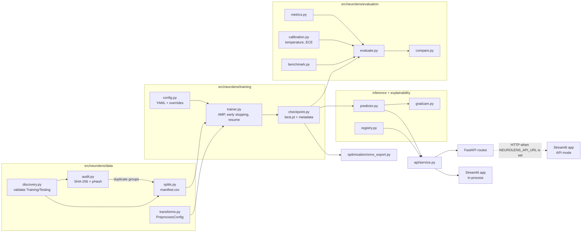

# Architecture

## Design decisions

* **`src/` layout with one importable package (`neurolens`).** The prompt's `src/data`,
  `src/models`, … structure is kept, but nested inside `src/neurolens/` so the code is importable
  as `neurolens.*` (installing a top-level package literally named `src` would collide with other
  projects). `api/` and `app/` stay at the repository root as deployable applications.
* **The checkpoint is the contract.** `best.pt` carries architecture, class names, preprocessing,
  configuration and software versions; inference, evaluation and export all rebuild from it and
  validate it. It is loaded with `torch.load(weights_only=True)`.
* **One service, two front doors.** `api/service.py` produces the Pydantic responses for both the
  FastAPI routes and the Streamlit page, so the UI cannot drift from the API contract.
* **Files over infrastructure.** Runs, metrics and reports are JSON/CSV/PNG files under
  `artifacts/`. No database, tracking server or message queue is required.
* **Honest absence.** Missing checkpoints, evaluations or benchmarks are reported as unavailable
  everywhere (CLI, API 503, UI empty states, `not trained` rows). Nothing substitutes random
  weights or placeholder numbers.
* **No OpenCV.** Pillow, NumPy and SciPy cover decoding, resizing, the DCT for perceptual hashing
  and colour mapping, so the heavyweight native dependency is unnecessary.
